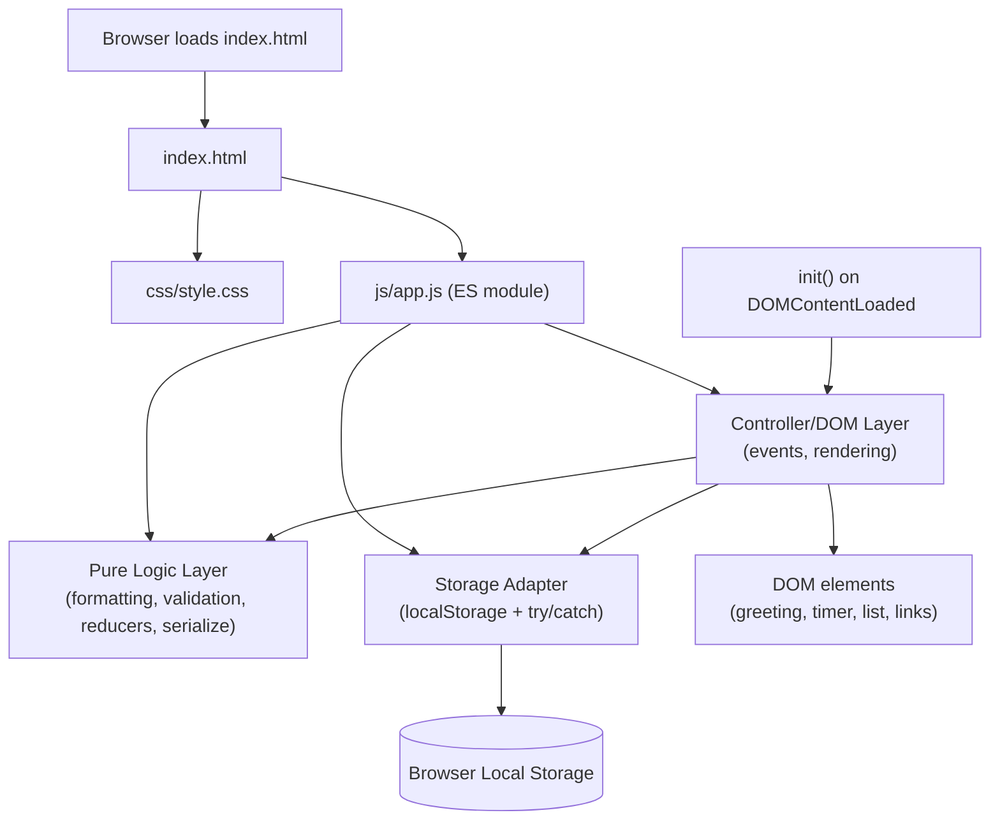
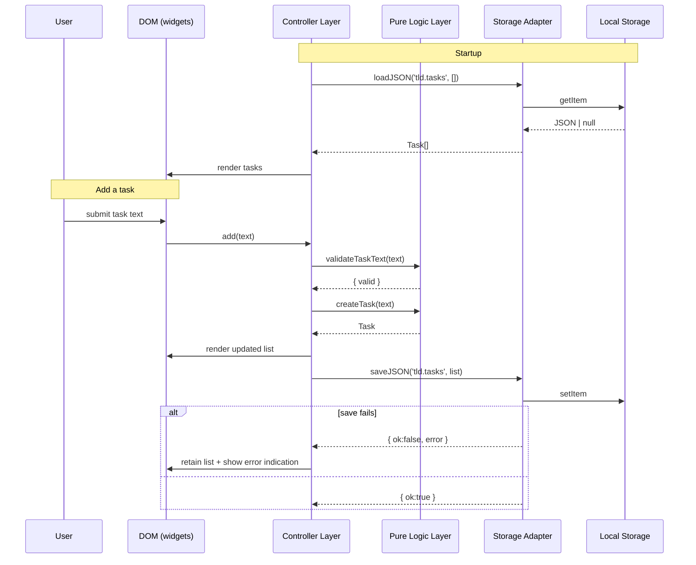

# Design Document

## Overview

This document presents the technical design for the **To-Do List Life Dashboard**, a client-side single-page web application that aggregates four lightweight productivity widgets — a contextual Greeting, a 25-minute Focus Timer, a To-Do List, and Quick Links — into one clean, minimal landing page.

The design satisfies the constraints and requirements defined in `requirements.md`:

- Plain HTML, exactly one CSS file inside `css/`, exactly one JavaScript file inside `js/`.
- No frameworks (no React/Vue/etc.), no build step, no backend server.
- Browser Local Storage API is the only persistence mechanism.
- Works in modern browsers (Chrome, Firefox, Edge, Safari); usable as a standalone web app or browser extension.
- Clean, minimal interface; fast load time; responsive UI.

### Design Goals

1. **Simplicity** — one HTML page, one stylesheet, one script. No tooling required to run the product.
2. **Offline-capable** — all state lives in Local Storage; the page works with no network.
3. **Testable logic** — pure functions (formatting, validation, state reducers, serialization) are isolated from DOM/side effects so they can be unit- and property-tested without a browser.
4. **Graceful degradation** — persistence failures never destroy in-memory data and always surface a non-blocking error indication.

### Research Summary

Two areas were researched to ground the design:

- **Property-based testing for vanilla JavaScript**: [fast-check](https://github.com/dubzzz/fast-check) is the standard PBT framework for JavaScript/TypeScript (QuickCheck-style). It lets us declare properties of the form "for all generated inputs X, predicate P(X) holds" and runs hundreds of randomized cases. It runs under Node and integrates with Vitest, so it can test the pure logic exported from `js/app.js` without affecting the shipped artifact.
- **Local Storage failure modes**: `localStorage.setItem` throws `QuotaExceededError` in Safari private-browsing mode ([Stack Overflow](https://stackoverflow.com/questions/21159301/quotaexceedederror-dom-exception-22-an-attempt-was-made-to-add-something-to-st), [TrackJS](https://trackjs.com/javascript-errors/failed-to-execute-setitem-on-storage/)). Worse, in some private modes `setItem` appears to succeed but stores nothing, so the next read returns `null` ([bswen.com](https://docs.bswen.com/blog/2026-04-07-fix-quotaexceedederror-localstorage/)). This means: (a) every storage call must be wrapped in `try/catch`; (b) loading must treat `null`/missing/malformed values as "no data" and fall back to an empty collection (Requirements 3.10, 4.8); (c) the save path should optionally read back to confirm the write for robustness.

## Architecture

### High-Level Architecture

The application is a single-page client-side app with no build step and no backend. The browser loads `index.html`, which pulls in `css/style.css` and `js/app.js` (loaded as an ES module so its pure functions can be imported by tests under Node).

Internally, `js/app.js` is organized into layered sections within the one file:

1. **Pure Logic Layer** — stateless functions: time/date formatting, greeting mapping, task/link validation, timer state reducer (`tick`/`start`/`stop`/`reset`), and serialization/deserialization. These have no DOM or storage dependencies and are the primary target for unit and property-based tests.
2. **Storage Adapter** — a thin wrapper around `localStorage` that serializes JSON, swallows/returns errors instead of throwing, and handles the silent-failure/null cases. All persistence in the app goes through this one path.
3. **Controller/DOM Layer** — wires pure logic to DOM elements: binds events (clicks, input, the 1-second clock tick), renders widget state into the DOM, and calls the Storage Adapter to persist after each mutation.
4. **Bootstrap** — a guarded `init()` that runs on `DOMContentLoaded`. The guard (`typeof document !== 'undefined'`) ensures the module's top level does not touch the DOM when imported by Node-based tests, so importing pure functions for testing never triggers UI side effects.



### Key Design Decisions

- **ES modules without a build step.** `js/app.js` uses `export` for its pure functions and is loaded with `<script type="module">`. This lets tests import the pure logic under Node (Vitest + fast-check) while keeping exactly one JS file in `js/`. No bundler is needed because modern browsers support ES modules natively.
- **Guarded bootstrap for testability.** DOM wiring lives in `init()`; the module's top level only calls it when `document` exists. Tests import pure functions without `document`, so no DOM code runs and no errors are thrown in Node.
- **Centralized Storage Adapter.** Every read/write funnels through one adapter that returns result objects (`{ ok: true }` / `{ ok: false, error }`) instead of throwing. This gives a single place to implement Requirements 3.10 and 4.8 (retain in-memory data on failure; empty set on missing data) and to handle Safari's silent-write failure.
- **Pure reducer for the Focus Timer.** The timer is modeled as `(state, action) -> newState`, with a real `setInterval` only driving repeated `tick` calls. This makes timer transitions property-testable and avoids drift by deriving the remaining time from timestamps rather than trusting `setInterval` precision.

## Components and Interfaces

Each widget is a self-contained module exposing a small interface. Pure functions are listed first (testable); side-effecting functions are listed last and are integration-tested.

### Storage Adapter

| Function | Signature | Description |
|---|---|---|
| `isStorageAvailable` | `() => boolean` | Probes localStorage by a trial setItem/getItem/removeItem inside try/catch; false in private mode where writes throw. |
| `loadJSON` | `(key: string, fallback: T) => T` | Reads and `JSON.parse`s `key`; on missing/`null`/malformed data or any throw, returns `fallback`. Supports Req 3.6/3.10, 4.5/4.8. |
| `saveJSON` | `(key: string, value: T) => { ok: true } \| { ok: false, error: unknown }` | `JSON.stringify`s and writes `key` inside try/catch; never throws. On failure returns the error so callers can show an indication and keep in-memory data (Req 3.10). |

### Greeting Widget

| Function | Signature | Description |
|---|---|---|
| `formatTime` | `(date: Date) => string` | Pure. Returns `"HH:MM"` 24-hour, zero-padded (Req 1.1). |
| `formatDate` | `(date: Date) => string` | Pure. Returns a string containing day, month, and year (Req 1.3). |
| `getGreeting` | `(hour: number) => string` | Pure. Maps an hour 0–23 to the time-of-day greeting (Req 1.4–1.7). |
| `startGreeting` | `(rootEl: HTMLElement) => void` | Side effect. Renders time/date/greeting and registers a 1-second `Clock_Tick` interval that re-renders (Req 1.2). |

### Focus Timer

| Function | Signature | Description |
|---|---|---|
| `createTimerState` | `() => TimerState` | Pure. Returns the initial 25:00 `idle` state (Req 2.1). |
| `formatTimer` | `(remainingMs: number) => string` | Pure. Returns zero-padded `"MM:SS"` for non-negative remaining time (Req 2.6). |
| `tick` | `(state: TimerState) => TimerState` | Pure reducer. Decrements remaining time by one second while `running`; stops at zero and becomes `finished`; no change otherwise (Req 2.2, 2.5). |
| `start` | `(state: TimerState) => TimerState` | Pure. Begins countdown from `idle`/`paused`; no-op when already `running` or `finished` (Req 2.2, 2.7, 2.8). |
| `stop` | `(state: TimerState) => TimerState` | Pure. Pauses a `running` countdown, retaining remaining time (Req 2.3). |
| `reset` | `(state: TimerState) => TimerState` | Pure. Restores 25:00 and stops; idempotent (Req 2.4). |
| `initTimer` | `(rootEl: HTMLElement) => void` | Side effect. Binds Start/Stop/Reset controls and drives `tick` via a 1-second interval; clears the interval on stop/reset to avoid leaks. |

### To-Do List

| Function | Signature | Description |
|---|---|---|
| `validateTaskText` | `(text: string) => { valid: boolean, reason?: string }` | Pure. Valid iff trimmed non-empty and length ≤ 200 (Req 3.1, 3.5, 3.9). |
| `createTask` | `(text: string) => Task` | Pure. Builds a task `{ done: false }` with a generated id (Req 3.1). |
| `toggleTask` | `(task: Task) => Task` | Pure. Flips `done` (Req 3.2). |
| `editTask` | `(task: Task, newText: string) => { ok: true, task: Task } \| { ok: false, reason: string }` | Pure. Updates text when valid; otherwise returns the error and the caller retains the original (Req 3.3, 3.9). |
| `deleteTask` | `(list: Task[], id: string) => Task[]` | Pure. Returns the list without the matching id, preserving order of the rest (Req 3.4). |
| `serializeTasks` | `(list: Task[]) => string` | Pure. JSON-encodes the list (Req 3.7, 3.8). |
| `deserializeTasks` | `(json: string) => Task[]` | Pure. JSON-decodes to a list; returns `[]` on null/missing/malformed (Req 3.6, 3.8). |
| `initTodo` | `(rootEl: HTMLElement, storage: StorageAdapter) => void` | Side effect. Loads saved tasks on startup, renders, binds add/edit/complete/delete, and persists after each mutation (Req 3.6, 3.7, 3.10). |

### Quick Links

| Function | Signature | Description |
|---|---|---|
| `validateLink` | `(name: string, url: string) => { valid: boolean, reason?: string }` | Pure. Valid iff name trimmed non-empty and length ≤ 100, and `url` starts with `http://` or `https://` (Req 4.2, 4.4). |
| `createLink` | `(name: string, url: string) => Link` | Pure. Builds a link with a generated id (Req 4.2). |
| `deleteLink` | `(list: Link[], id: string) => Link[]` | Pure. Removes the matching id, preserving the rest (Req 4.3). |
| `serializeLinks` | `(list: Link[]) => string` | Pure. JSON-encodes the link set (Req 4.6, 4.7). |
| `deserializeLinks` | `(json: string) => Link[]` | Pure. JSON-decodes; returns `[]` on null/missing/malformed (Req 4.5, 4.7, 4.8). |
| `openLink` | `(url: string) => void` | Side effect. Calls `window.open(url, '_blank')` (Req 4.1). |
| `initLinks` | `(rootEl: HTMLElement, storage: StorageAdapter) => void` | Side effect. Loads saved links on startup, renders buttons, binds add/remove/open, and persists after mutations (Req 4.5, 4.6). |

### Component Interaction



## Data Models

All persistent data is stored as JSON strings in Local Storage under namespaced keys.

### Task

```ts
interface Task {
  id: string;      // unique identifier
  text: string;    // description, 1..200 non-whitespace characters
  done: boolean;   // completion status, defaults false on creation
}
```

### Link

```ts
interface Link {
  id: string;    // unique identifier
  name: string;  // display label, 1..100 non-whitespace characters
  url: string;   // destination, must start with http:// or https://
}
```

### TimerState

```ts
interface TimerState {
  remainingMs: number;                                  // milliseconds left, >= 0
  status: 'idle' | 'running' | 'paused' | 'finished';   // current phase
}
```

- Initial state: `{ remainingMs: 25 * 60 * 1000, status: 'idle' }`.
- `finished` is reached when a running countdown hits zero; `tick` then holds remaining at `0`.

### Local Storage Keys

| Key | Value | Owner |
|---|---|---|
| `tld.tasks` | `JSON.stringify(Task[])` | To-Do List |
| `tld.links` | `JSON.stringify(Link[])` | Quick Links |

### ID Generation

IDs are generated with `crypto.randomUUID()` when available (all target modern browsers and Node ≥ 19), with a fallback for older runtimes:

```js
function makeId() {
  if (typeof crypto !== 'undefined' && crypto.randomUUID) return crypto.randomUUID();
  return Date.now().toString(36) + Math.random().toString(36).slice(2, 10);
}
```

### Serialization Shape

The serialized form preserves array order so list position is stable across a round-trip (Req 3.8, 4.7):

```json
[
  { "id": "uuid", "text": "Write design doc", "done": false },
  { "id": "uuid", "text": "Review PR", "done": true }
]
```

## Correctness Properties

*A property is a characteristic or behavior that should hold true across all valid executions of a system — essentially, a formal statement about what the system should do. Properties serve as the bridge between human-readable specifications and machine-verifiable correctness guarantees.*

PBT applies to this feature because a large portion of the logic is pure functions with input-dependent behavior (formatters, validators, a timer reducer, and serializers) plus two explicit round-trip requirements (3.8 and 4.7). The properties below target that pure-logic layer; DOM rendering, intervals, and `window.open` are covered by integration tests in the Testing Strategy.

The following properties were derived from the prework analysis, with redundant criteria consolidated (greeting ranges 1.4–1.7; timer tick/zero 2.2+2.5; timer start no-op 2.7+2.8; task validation 3.1+3.5; edit validation 3.3+3.9; link validation 4.2+4.4).

### Property 1: Time display formatting (24-hour)

*For any* `Date`, `formatTime(date)` SHALL return a string matching `^\d{2}:\d{2}$` equal to the zero-padded 24-hour `HH:MM` derived from that date (hours 0–23, minutes 0–59).

**Validates: Requirements 1.1**

### Property 2: Date display formatting

*For any* `Date`, `formatDate(date)` SHALL return a string that contains the numeric day, month, and year derived from that same date.

**Validates: Requirements 1.3**

### Property 3: Greeting maps each hour to the correct phrase

*For any* integer hour `h` in 0..23, `getGreeting(h)` SHALL equal `"Good evening"` for 0–4 and 17–23, `"Good morning"` for 5–11, and `"Good afternoon"` for 12–16.

**Validates: Requirements 1.4, 1.5, 1.6, 1.7**

### Property 4: Timer tick decrements while running and stops at zero

*For any* `TimerState` that is `running` with `remainingMs > 1000`, `tick(state)` SHALL reduce `remainingMs` by exactly 1000 and remain `running`; *for any* `running` state at or below 1000 ms, repeated `tick` calls SHALL converge `remainingMs` to `0` and transition to `finished`, after which further ticks SHALL leave it at `0`/`finished`.

**Validates: Requirements 2.2, 2.5**

### Property 5: Stop preserves remaining time

*For any* `running` `TimerState`, `stop(state)` SHALL produce a `paused` state with `remainingMs` unchanged.

**Validates: Requirements 2.3**

### Property 6: Reset restores 25:00 and is idempotent

*For any* `TimerState`, `reset(state)` SHALL yield `{ remainingMs: 1500000, status: 'idle' }`, and `reset(reset(state))` SHALL equal `reset(state)`.

**Validates: Requirements 2.4**

### Property 7: Start is a no-op when already running or at zero

*For any* `TimerState` whose status is `running` or `finished`, `start(state)` SHALL return a state with `remainingMs` and `status` unchanged.

**Validates: Requirements 2.7, 2.8**

### Property 8: Timer remaining formats as zero-padded MM:SS

*For any* non-negative integer `remainingMs`, `formatTimer(remainingMs)` SHALL match `^\d{2}:\d{2}$` and equal `MM:SS` where `MM` and `SS` are zero-padded minutes and seconds derived from `remainingMs`.

**Validates: Requirements 2.6**

### Property 9: Task text validation and creation

*For any* string `text`, `validateTaskText(text)` SHALL be valid iff `text.trim()` is non-empty and `text.length <= 200`; *for any* valid `text`, `createTask(text)` SHALL produce a task with the given text and `done === false`.

**Validates: Requirements 3.1, 3.5**

### Property 10: Toggling completion is a round-trip

*For any* `Task`, `toggleTask(toggleTask(task))` SHALL equal `task`, and a single `toggleTask(task)` SHALL flip `done`.

**Validates: Requirements 3.2**

### Property 11: Edit validation retains the original on invalid input

*For any* `Task` and string `newText`, `editTask` SHALL succeed iff `validateTaskText(newText)` is valid (and then set `text` to `newText`, `done` unchanged); when invalid it SHALL fail, and the original task's `text` and `done` SHALL remain unchanged.

**Validates: Requirements 3.3, 3.9**

### Property 12: Deleting a task removes it and preserves the rest

*For any* `Task[]` `list` and id present in it, `deleteTask(list, id)` SHALL produce a list that contains no task with that id, preserves all other tasks in their original order, and has length `list.length - 1`.

**Validates: Requirements 3.4**

### Property 13: Task list round-trip through Local Storage

*For any* `Task[]` `list`, `deserializeTasks(serializeTasks(list))` SHALL be an array equal to `list` element-for-element, preserving each task's `text`, `done`, and list position.

**Validates: Requirements 3.8**

### Property 14: Link validation and creation

*For any* `name` and `url`, `validateLink(name, url)` SHALL be valid iff `name.trim()` is non-empty, `name.length <= 100`, and `url` starts with `http://` or `https://`; *for any* valid pair, `createLink(name, url)` SHALL produce a link with the given name and url.

**Validates: Requirements 4.2, 4.4**

### Property 15: Deleting a link removes it and preserves the rest

*For any* `Link[]` `list` and id present in it, `deleteLink(list, id)` SHALL produce a list with no link of that id, preserving all other links in order, of length `list.length - 1`.

**Validates: Requirements 4.3**

### Property 16: Link set round-trip through Local Storage

*For any* `Link[]` `list`, `deserializeLinks(serializeLinks(list))` SHALL equal `list` element-for-element, preserving each link's `name` and `url`.

**Validates: Requirements 4.7**

### Property 17: Missing stored link set loads as empty

*For any* of `null`, `undefined`, `""`, or malformed JSON, `loadLinks` SHALL yield an empty array.

**Validates: Requirements 4.8**

### Property 18: Persistence failure leaves the in-memory task list unchanged

*For any* in-memory `Task[]` and a storage adapter whose `saveJSON` throws or returns `{ ok: false }`, a failed save SHALL leave the in-memory list unchanged and set an error indication.

**Validates: Requirements 3.10**

## Error Handling

Error handling is centralized and defensive; nothing the user does should throw an uncaught exception or destroy in-memory data.

### Local Storage failures (Req 3.10, 4.5, 4.8)

- **Unavailable / private mode** (`QuotaExceededError` or `setItem` throwing): `isStorageAvailable()` detects this at startup; `saveJSON` wraps every write in `try/catch` and returns `{ ok: false, error }` instead of throwing. Callers keep the in-memory list and surface a non-blocking error indication (e.g., a small inline message near the widget) — they never clear data on a failed save.
- **Silent write failure** (Safari private mode: `setItem` "succeeds" but nothing is stored): mitigated by the load path treating `null`/missing as "no data" → empty collection, so the app degrades to a fresh session rather than crashing. An optional read-back verification after `saveJSON` can confirm the write; if it mismatches, the save is treated as failed and the same error indication is shown.
- **Malformed stored JSON**: `loadJSON`/`deserialize*` catch parse errors and return the fallback (empty list), so a corrupted key never breaks startup.

### Input validation errors (Req 3.5, 3.9, 4.4)

- Invalid task text (empty/whitespace-only or > 200 chars) and invalid links (empty/whitespace/over-100 name, or non-`http(s)://` URL) are rejected before any mutation. The relevant input shows a short, non-blocking, dismissible error message ("Task text is required", "Enter a valid http/https URL", etc.) and the displayed list/set is unchanged. No task/link is added on rejection.

### Focus Timer edge cases (Req 2.5, 2.7, 2.8)

- Remaining time is clamped to `>= 0`; reaching zero transitions to `finished` and `tick`/`start` are no-ops thereafter.
- `start` is a no-op when already `running` or `finished`, so repeated Start clicks never alter remaining time or spawn duplicate intervals.
- The driving `setInterval` is cleared on `stop` and `reset` to prevent interval leaks and drift; remaining time is derived from timestamps rather than counting `setInterval` firings, keeping accuracy across throttled background tabs.

### Opening links (Req 4.1)

- `window.open(url, '_blank')` may be blocked by a popup blocker and return `null`. The controller detects `null` and falls back to navigating the current tab (`window.location.href = url`) or showing a brief message, so the click always produces a result.

### Defensive DOM access

- All element lookups are null-checked; if a widget's root element is absent, its initializer returns early rather than throwing, so a partial DOM never breaks the rest of the dashboard.

## Testing Strategy

### Dual testing approach

- **Unit tests (example-based)** — cover specific examples, edge cases, and integration points (DOM wiring via a DOM emulation library, mocked Local Storage, mocked `window.open`). These catch concrete bugs and verify the controller layer.
- **Property-based tests (fast-check)** — cover universal properties of the pure-logic layer (the 18 Correctness Properties above). Each runs a minimum of 100 randomized iterations and is tagged with a comment referencing its design property, using the format: **Feature: todo-life-dashboard, Property N: &lt;property text&gt;**.

PBT is appropriate here because the properties target in-memory pure functions (formatters, validators, the timer reducer, serializers) where behavior varies meaningfully with input and 100+ iterations cheaply expose edge cases (whitespace-only strings, length boundaries, hour boundaries, zero-clamping, round-trip fidelity). DOM rendering, intervals, and external calls (`window.open`, real `localStorage`) are tested with examples/integration instead.

### Test infrastructure

- **Runner:** Vitest (fast, native ES-module support, runs under Node). Installed only as a dev dependency — it does not alter the production folder rule of exactly one CSS file in `css/` and one JS file in `js/`.
- **PBT library:** [fast-check](https://github.com/dubzzz/fast-check).
- **DOM emulation:** `happy-dom` (lightweight) for controller-layer integration tests that need `document`.
- **Tests live in a `test/` directory at the project root**, outside `js/` and `css/`, importing the pure functions exported from `js/app.js`. Because `app.js` guards its `init()` with `typeof document !== 'undefined'`, importing it under Node runs no DOM code.
- Run with `npx vitest run` (single execution, not watch) for property and unit suites.

### Test type per acceptance criterion

| Criterion | Type | Notes |
|---|---|---|
| 1.1, 1.3 | PROPERTY | time/date formatting |
| 1.2 | INTEGRATION | clock-tick DOM update with fake timers |
| 1.4–1.7 | PROPERTY | greeting hour mapping (consolidated) |
| 2.1 | EXAMPLE | initial 25:00 state/display |
| 2.2, 2.5 | PROPERTY | tick decrement + zero clamp |
| 2.3 | PROPERTY | stop preserves time |
| 2.4 | PROPERTY | reset to 25:00, idempotent |
| 2.6 | PROPERTY + EXAMPLE | MM:SS format; cadence via example |
| 2.7, 2.8 | PROPERTY | start no-op in running/finished |
| 3.1, 3.5 | PROPERTY | task text validation |
| 3.2 | PROPERTY | toggle round-trip |
| 3.3, 3.9 | PROPERTY | edit validation retains original |
| 3.4 | PROPERTY | delete preserves others |
| 3.6 | INTEGRATION | load-on-startup with mocked storage |
| 3.7 | INTEGRATION | persist-after-mutation with mocked storage |
| 3.8 | PROPERTY | task round-trip |
| 3.10 | EDGE_CASE | failing-storage mock leaves list unchanged |
| 4.1 | INTEGRATION | mocked `window.open` new tab |
| 4.2, 4.4 | PROPERTY | link validation |
| 4.3 | PROPERTY | delete link preserves others |
| 4.5 | INTEGRATION | load-on-startup with mocked storage |
| 4.6 | INTEGRATION | persist-after-mutation with mocked storage |
| 4.7 | PROPERTY | link round-trip |
| 4.8 | EDGE_CASE / PROPERTY | missing data loads empty |

### Property test configuration requirements

- Minimum 100 iterations per property test.
- Each property test must reference its design property in a comment tag: **Feature: todo-life-dashboard, Property N: &lt;text&gt;**.
- Each correctness property is implemented as a single property-based test.
- Generators must cover the documented edge cases: whitespace-only strings, length boundaries (200 for tasks, 100 for link names), hour boundaries (4/5, 11/12, 16/17), zero/negative remaining time, and empty/`null`/malformed stored JSON.
